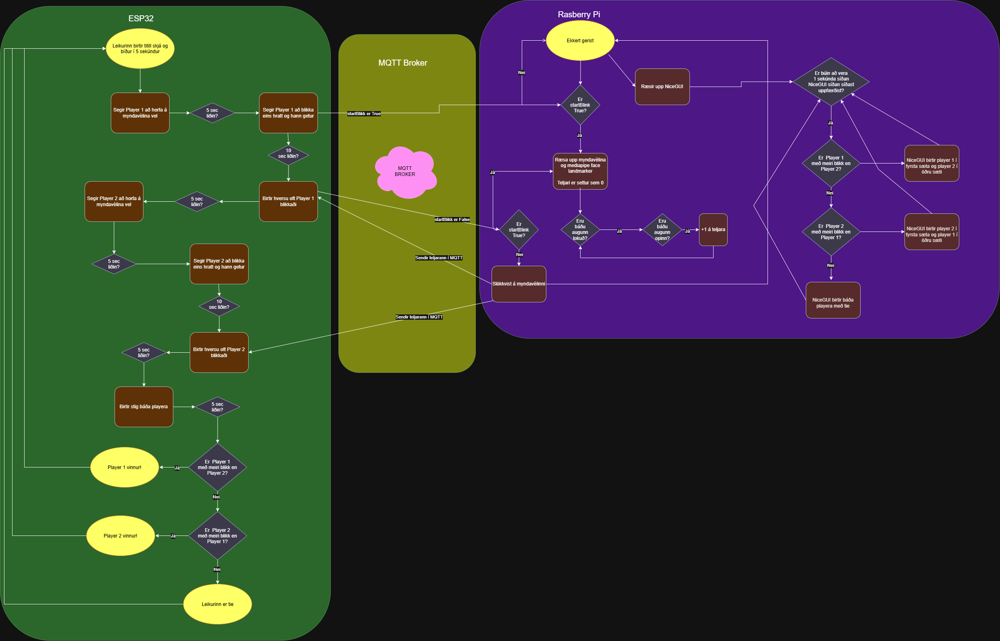
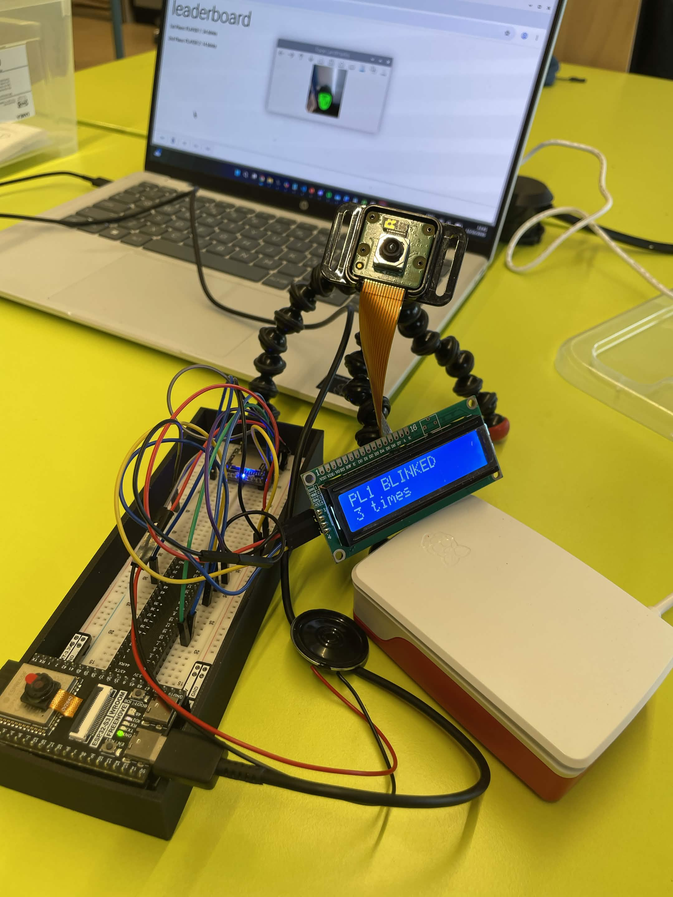
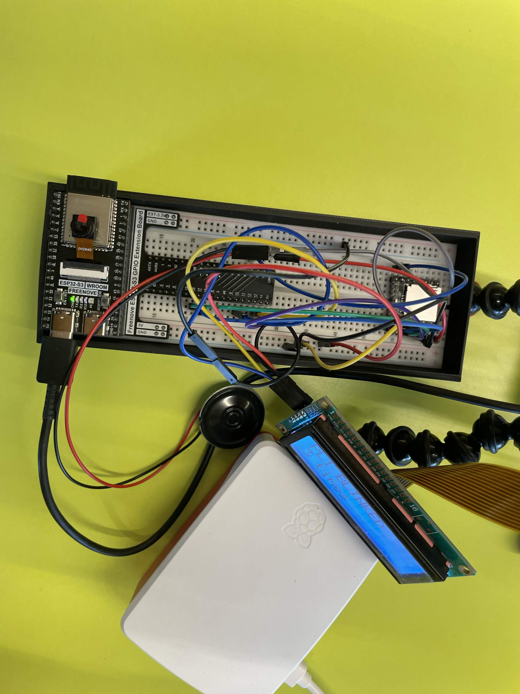
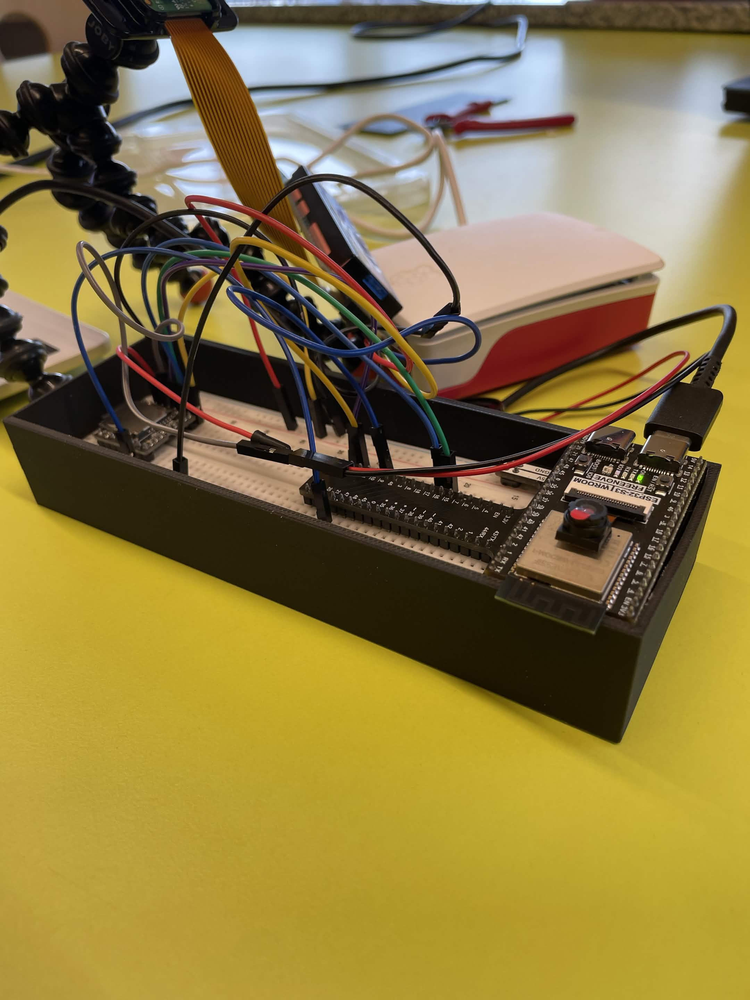
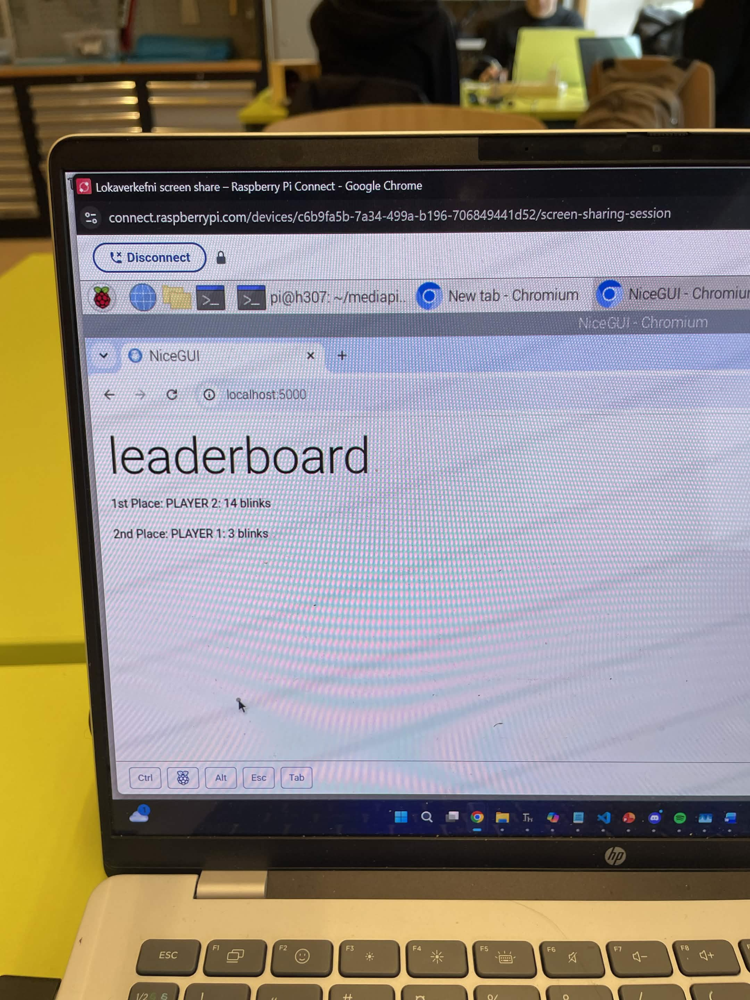
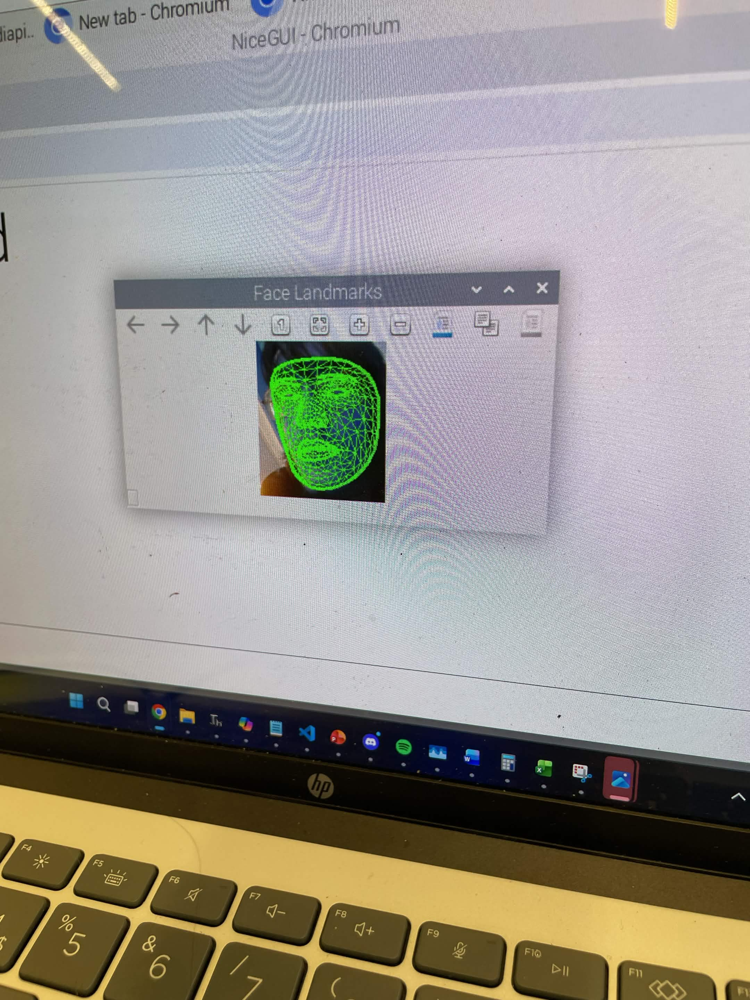

# BLIKK KEPPNI
### Leikmenn: 2

Leikurinn byrjar með að hafa 2 leikmenn, þegar leikurinn ræstist á leikmaður 1 að byrja. 
Það er telt niður frá 5 og bendir leikmannin á að horfa vel á myndavélina (ekki hafa neitt sem getur látt augun vera falin, eins og gleraugu eða hár) 
Svo telur það niður frá 10 og leikmaðurinn á að blikka eins hratt og hann getur í 10 sekúndur. 
Eftir það, leikmaður 2 gerir sama sem leikmaður 1 var að gera. 
Eftir báðir leikmenn klára að blikka, það teljir stiginn þeirra og sigurverainn er hann sem blikkar mest, og leikurinn byrjar aftur upp á nýtt. 

# ALLIR ÍHLUTIR
- [ ] I2C LCD Display
- [ ] MP3-TF-16P
- [ ] Raspberry Pi 5
- [ ] Camera module 3 wide
- [ ] Speaker 8Ω 0.5W
- [ ] Freenove ESP32-S3 GPIO Extension Board
- [ ] ESP-32-S3 WROOM
- [ ] breadboard

# MYNDRIT

# MYNDIR OG VIDEO

## myndband
[https://drive.google.com/file/d/13181E7xa-tt3CdwBbOh02IFbvfLKToIK/view?usp=sharing](https://drive.google.com/file/d/13181E7xa-tt3CdwBbOh02IFbvfLKToIK/view?usp=sharing)
